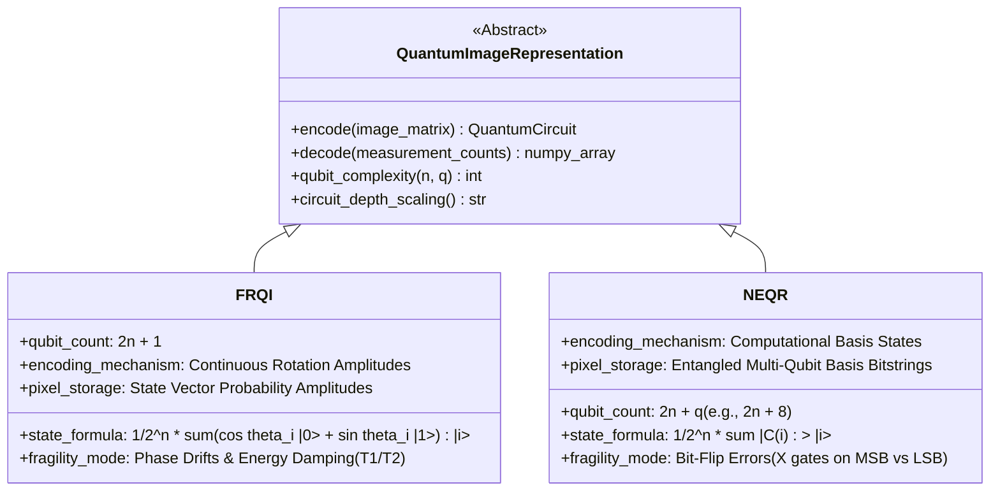
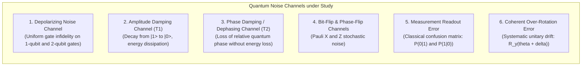
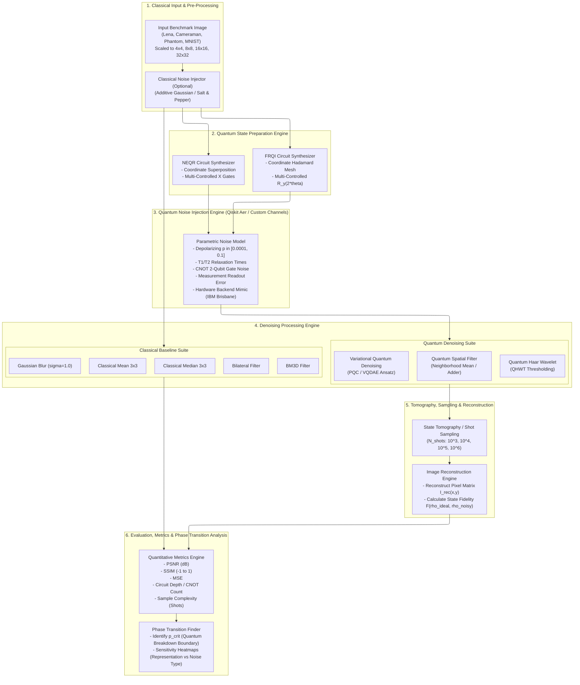
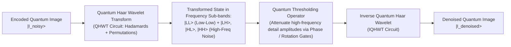
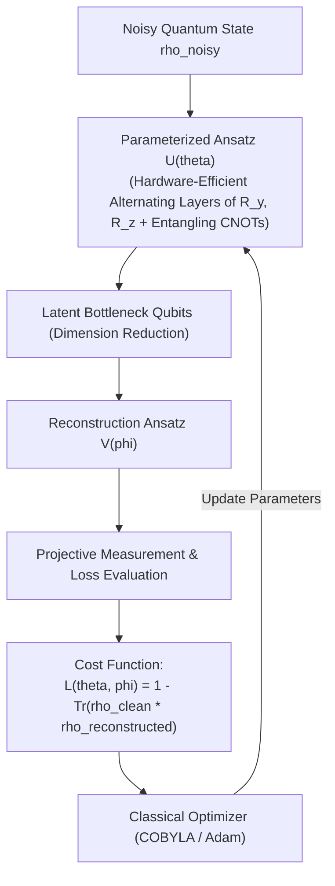
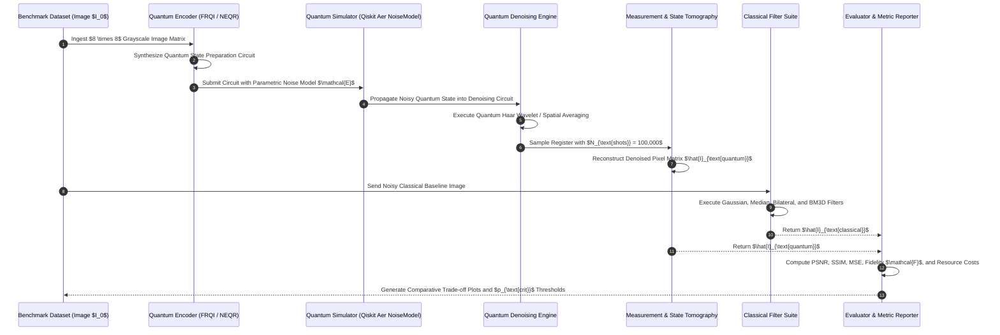
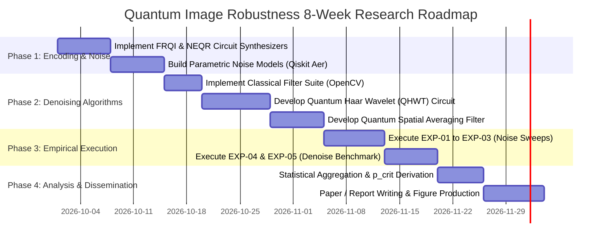

# Quantum Image Robustness & Denoising --- Research & Engineering Plan

> **How Robust Are Quantum Images? Investigating Noise Propagation, Representation Fragility, and Quantum-Assisted Denoising under NISQ Realities**
>
> An Empirical and Theoretical Quantum Computing Research & Systems Engineering Plan comparing **FRQI** (Flexible Representation of Quantum Images) and **NEQR** (Novel Enhanced Quantum Representation) under realistic quantum noise channels (Depolarizing, Amplitude Damping $T_1$, Dephasing $T_2$, and Readout Error), formulating a **Quantum-Assisted Wavelet/Spatial Denoising Pipeline**, and establishing the critical breakdown boundary where quantum representations collapse compared to classical filters (Gaussian, Median, Bilateral, BM3D).

------------------------------------------------------------------------

## 1. Project Overview

Quantum Image Processing (QIP) is an emerging subfield of quantum information science that harnesses superposition, entanglement, and quantum interference to perform visual computational tasks—such as edge detection, image segmentation, filtering, and classification—with theoretical polynomial or exponential speedups over classical algorithms.

However, the vast majority of published literature on QIP assumes an **ideal, fault-tolerant quantum computer** running error-free unitary operations on pure quantum states $|\psi\rangle$. Real-world quantum processors in the **Noisy Intermediate-Scale Quantum (NISQ)** era are inherently open quantum systems subject to environmental decoherence, gate infidelity, coherent over-rotation errors, and measurement readout confusion. 

**This research plan provides a complete blueprint for an empirical and theoretical investigation into:**
1. **Representation-Dependent Noise Fragility:** How environmental noise maps into reconstructed spatial pixels across fundamentally different quantum image encoding paradigms (Continuous Amplitude Encoding in **FRQI** vs. Discrete Basis State Encoding in **NEQR**).
2. **Quantum-Assisted Image Denoising:** Developing and benchmarking quantum image filtering circuits (Quantum Spatial Neighborhood Filters, Quantum Haar Wavelet Transform thresholding, and Variational Quantum Denoising Circuits).
3. **Quantum vs. Classical Performance Trade-offs:** Rigorous empirical benchmarking across Peak Signal-to-Noise Ratio (PSNR), Structural Similarity Index (SSIM), Mean Squared Error (MSE), Quantum State Fidelity ($\mathcal{F}$), circuit depth, and shot sampling complexity against state-of-the-art classical filters.
4. **Identification of Failure Thresholds:** Mapping the empirical phase transition boundary ($p_{\text{crit}}$) beyond which quantum image information becomes irreversibly corrupted and quantum filtering advantages vanish.

------------------------------------------------------------------------

## 2. Research Problem & Theoretical Motivation

### The Problem Statement
In classical image processing, image noise typically arises from physical sensors, thermal fluctuations, or transmission loss (e.g., Additive White Gaussian Noise, Salt-and-Pepper impulse noise, Poisson photon noise). In quantum computing, noise manifests fundamentally at the quantum state level as **completely positive trace-preserving (CPTP) quantum operations** acting on density matrices $\rho$:

$$\rho \mapsto \mathcal{E}(\rho) = \sum_k E_k \rho E_k^\dagger, \quad \sum_k E_k^\dagger E_k = I$$

When an image is encoded into a quantum register, quantum noise does not simply corrupt pixel values independently; it corrupts the quantum state's amplitudes and phases, causing **non-local, cross-pixel error propagation** upon projective measurement.

```
Classical Noise Model:
[Clean Pixel I(x,y)] ──> [+ Gaussian / Impulse Noise] ──> [Noisy Pixel I'(x,y)] (Local Corruption)

Quantum Image Noise Pipeline (NISQ):
[Clean Image] ──> [State Preparation U_prep] ──> [Noisy Quantum Channel E] 
  ──> [Quantum Processing / Denoising Circuit U_proc] ──> [Measurement / Tomography M] 
  ──> Non-Local, Entanglement-Propagated Reconstruction Artifacts!
```

### Core Research Questions (RQs):
- **RQ1 (Representation Fragility):** Does continuous amplitude encoding (FRQI) exhibit higher vulnerability to phase dephasing ($T_2$) and amplitude damping ($T_1$) compared to discrete computational basis encoding (NEQR)? How do bit-flip ($X$) errors in NEQR compare to angle rotation drifts ($\Delta \theta$) in FRQI?
- **RQ2 (Error Localization vs Non-Local Bleed):** In multi-qubit entanglement networks used for coordinate addressing, does a single physical gate failure corrupt an isolated pixel or bleed across an entire quadrant/row due to controlled multiplexer cascade gates?
- **RQ3 (Quantum-Assisted Denoising Feasibility):** Can a quantum spatial filter or Quantum Haar Wavelet Transform (QHWT) filter out noise on a noisy quantum simulator or real NISQ device, or does the added gate depth of the denoising circuit introduce more noise than it eliminates?
- **RQ4 (The Quantum Advantage Horizon):** At what physical error rate $p_{\text{crit}}$ and shot budget $N_{\text{shots}}$ does classical filtering strictly dominate quantum-assisted approaches in both PSNR and computational runtime?

------------------------------------------------------------------------

## 3. Project Goals

### Primary Research Goal
Quantify the mathematical and empirical relationship between physical quantum noise channels and image reconstruction fidelity across **FRQI** and **NEQR** representations, implement a functional **Quantum-Assisted Denoising Pipeline**, and delineate the operational regimes where quantum image processing remains viable versus where it collapses.

### Secondary Engineering & Academic Goals
- **Formal Mathematical Noise Mapping:** Derive analytical expressions for pixel variance $\sigma^2_{\text{pixel}}$ as a function of depolarizing parameter $p$, damping parameter $\gamma$, and circuit depth $D$.
- **Parametric Noise Simulation:** Implement parameterized noise models in **Qiskit Aer** and **PennyLane** reproducing actual IBM Quantum QPUs (e.g., `ibm_brisbane`, `ibm_kyoto`).
- **Quantum Image Encoders:** Build scalable, automated state-preparation transpilers for $2^n \times 2^n$ images (from $4 \times 4$ and $8 \times 8$ up to $32 \times 32$ pixels).
- **Quantum Denoising Implementations:**
  1. *Quantum Spatial Averaging Filter (NEQR + Quantum Adder / Shift Registers).*
  2. *Quantum Haar Wavelet Transform (QHWT) with High-Frequency Amplitude Attenuation.*
  3. *Variational Quantum Denoising Autoencoder (VQDAE / PQC).*
- **Comprehensive Classical Benchmarking:** Direct comparative evaluation against Classical Mean Filter, Median Filter, Gaussian Smoothing, Bilateral Filter, and BM3D (Block-Matching and 3D filtering).
- **Extensive Metric Suite:** Automated calculation of PSNR, SSIM, MSE, State Fidelity $\mathcal{F}(\rho_{\text{ideal}}, \rho_{\text{noisy}})$, circuit CNOT depth, and total quantum execution time.
- **Reproducible Open-Source Framework:** Deliver a modular, documented Python repository with interactive Jupyter experiment notebooks, automated testing, and publication-ready figures.

------------------------------------------------------------------------

## 4. Quantum Image Representations: FRQI vs. NEQR

To understand how noise propagates, we must contrast the two foundational quantum image encodings:



### 4.1 Flexible Representation of Quantum Images (FRQI)
For a $2^n \times 2^n$ grayscale image where pixel $(x, y)$ has normalized grayscale value $\theta_i \in [0, \pi/2]$:

$$|I_{\text{FRQI}}\rangle = \frac{1}{2^n} \sum_{i=0}^{2^{2n}-1} \Big( \cos \theta_i |0\rangle + \sin \theta_i |1\rangle \Big) \otimes |i\rangle$$

- **Qubit Requirement:** $2n + 1$ qubits ($2n$ for coordinate position $|i\rangle = |y\rangle|x\rangle$, and $1$ auxiliary color qubit).
- **Advantage:** Highly economical qubit count (an $8 \times 8$ image requires only $2(3) + 1 = 7$ qubits).
- **Vulnerability to Noise:** Pixel intensity is encoded directly in the probability amplitude $P(1|i) = \sin^2 \theta_i$. Any amplitude damping or rotation over/under-shoot directly perturbs the pixel intensity continuously. Readout measurement requires massive shot counts ($N_{\text{shots}} \ge 10^5$) to reconstruct $\sin^2 \theta_i$ accurately.

### 4.2 Novel Enhanced Quantum Representation (NEQR)
For an 8-bit grayscale image where pixel intensity $C(i) \in [0, 255]$ is represented as an 8-bit binary string $C_7 C_6 \dots C_0$:

$$|I_{\text{NEQR}}\rangle = \frac{1}{2^n} \sum_{i=0}^{2^{2n}-1} |C_7(i) C_6(i) \dots C_0(i)\rangle \otimes |i\rangle$$

- **Qubit Requirement:** $2n + q$ qubits ($2n$ for coordinate position, $q=8$ for color register).
- **Advantage:** Exact basis state encoding allows quadratic speedups in arithmetic processing (quantum adders, comparators, and transformations can operate directly via reversible logic gates).
- **Vulnerability to Noise:** Susceptible to bit-flip noise. Crucially, a bit-flip on the Most Significant Bit ($C_7$) induces a catastrophic intensity jump of $\pm 128$, whereas a flip on the Least Significant Bit ($C_0$) induces a negligible jump of $\pm 1$.

------------------------------------------------------------------------

## 5. Quantum Noise Channels & Error Models

The study models physical noise via Kraus operator formulations $\mathcal{E}(\rho) = \sum_k E_k \rho E_k^\dagger$:



### 5.1 Depolarizing Channel
Represents the isotropic loss of quantum information with error probability $p$:
$$\mathcal{E}_{\text{depol}}(\rho) = (1 - p)\rho + \frac{p}{3} \big( X\rho X + Y\rho Y + Z\rho Z \big)$$
For 2-qubit gates (CNOT, CZ), 2-qubit depolarizing noise with error rate $p_2 \approx 10 \times p_1$ is injected, reflecting the physical reality of superconducting qubits.

### 5.2 Amplitude Damping Channel ($T_1$ Relaxation)
Models spontaneous emission of energy into the environment:
$$E_0 = \begin{pmatrix} 1 & 0 \\ 0 & \sqrt{1 - \gamma} \end{pmatrix}, \quad E_1 = \begin{pmatrix} 0 & \sqrt{\gamma} \\ 0 & 0 \end{pmatrix}$$
where $\gamma = 1 - e^{-t / T_1}$. This causes continuous decay of $|1\rangle \to |0\rangle$, systematically dimming FRQI images and biasing NEQR bitstrings towards $0$.

### 5.3 Phase Damping Channel ($T_2$ Dephasing)
Destroys quantum coherence without changing energy state populations:
$$E_0 = \begin{pmatrix} 1 & 0 \\ 0 & \sqrt{1 - \lambda} \end{pmatrix}, \quad E_1 = \begin{pmatrix} 0 & 0 \\ 0 & \sqrt{\lambda} \end{pmatrix}$$
where $\lambda = 1 - e^{-t / T_{\phi}}$.

### 5.4 Readout Assignment Error
Simulated via asymmetric transition probability matrix:
$$\Lambda = \begin{pmatrix} 1 - P(1|0) & P(0|1) \\ P(1|0) & 1 - P(0|1) \end{pmatrix}$$

------------------------------------------------------------------------

## 6. End-to-End System Architecture



------------------------------------------------------------------------

## 7. PEAS Specification

The formal agent/systems problem definition for the research framework:

| Component | Formal Definition |
| :--- | :--- |
| **Performance Measure (P)** | - **Reconstruction Fidelity:** PSNR (dB), SSIM, and MSE between clean reference image $I_0$ and reconstructed image $\hat{I}$.<br>- **Quantum State Fidelity:** $\mathcal{F}(\rho_{\text{ideal}}, \rho_{\text{noisy}}) = \big(\text{Tr}\sqrt{\sqrt{\rho_{\text{ideal}}}\rho_{\text{noisy}}\sqrt{\rho_{\text{ideal}}}}\big)^2$.<br>- **Noise Resilience Index:** $\Delta \text{PSNR} / \Delta p$ (rate of quality degradation per unit noise).<br>- **Denoising Efficiency:** $\text{PSNR}_{\text{denoised}} - \text{PSNR}_{\text{noisy}}$ for both quantum and classical filters.<br>- **Computational Resource Overhead:** 2-qubit CNOT gate count, circuit depth, total shot budget $N_{\text{shots}}$. |
| **Environment (E)** | - Quantum Simulators: Qiskit Aer (`QasmSimulator`, `DensityMatrixSimulator`, `AerSimulator.from_backend`).<br>- PennyLane default.qubit / default.mixed.<br>- Simulated physical hardware topologies (IBM Eagle 127-qubit, Heron 133-qubit with heavy-hex coupling).<br>- Benchmark image corpora: Standard test patterns (Checkerboard, Grayscale Gradient, Shepp-Logan Phantom, Cameraman, MNIST digits). |
| **Actuators (A)** | - State preparation circuit transpiler (FRQI / NEQR builder).<br>- Noise model parameter injector (Kraus operator builder).<br>- Quantum gate sequence executor (Quantum spatial filter, QHWT, VQDAE optimizer).<br>- Quantum measurement sampler ($Z$-basis projective measurement).<br>- Classical digital filter library (OpenCV, SciPy, BM3D).<br>- Automated plotting and phase-transition boundary detector. |
| **Sensors / Percepts (S)** | - Raw image pixel arrays ($N \times N$, 8-bit uint8 or normalized float).<br>- Quantum measurement counts dictionary (e.g., `{'00101': 412, '00110': 588}`).<br>- Quantum circuit DAG (Directed Acyclic Graph) representation and gate statistics.<br>- Hardware calibration profiles (qubit $T_1$, $T_2$, single-qubit gate error, CNOT error, readout error). |

------------------------------------------------------------------------

## 8. Quantum-Assisted Denoising Pipeline

### 8.1 Method 1: Quantum Haar Wavelet Transform (QHWT) Denoising
The Quantum Haar Wavelet Transform decomposes an image into spatial approximation (low-frequency) and detail (high-frequency horizontal, vertical, diagonal) coefficients:



- **Mechanism:** Since high-frequency sub-bands ($|LH\rangle, |HL\rangle, |HH\rangle$) store rapid intensity variations, random uncorrelated quantum noise concentrates heavily in these sub-bands. Controlled attenuation of detail amplitudes suppresses noise while preserving major structural edges in the low-low ($|LL\rangle$) approximation band.

### 8.2 Method 2: Quantum Spatial Moving Average Filter (NEQR)
For an NEQR image, a $3 \times 3$ or $2 \times 2$ spatial moving average computes:
$$\hat{C}(x, y) = \frac{1}{4} \sum_{\Delta x=0}^1 \sum_{\Delta y=0}^1 C(x + \Delta x, y + \Delta y)$$
- **Quantum Arithmetic Implementation:** Utilizes Quantum Adders (Draper QFT Adders or Carry-Ripple Adders) and cyclic quantum coordinate shift gates ($U_{+1}, U_{-1}$).
- **Division by 4:** Performed in NEQR via a trivial right-shift of color basis qubits (qubit truncation of the 2 least significant bits).

### 8.3 Method 3: Variational Quantum Denoising Autoencoder (VQDAE)
A Parametrized Quantum Circuit (PQC) trained to project corrupted quantum states onto a clean manifold:



------------------------------------------------------------------------

## 9. Classical Baseline Filter Suite

To rigorously validate any claims of quantum advantage or equivalence, the framework implements an exhaustive suite of classical filters executed on the identical noisy inputs:

| Classical Filter | Mathematical Formulation | Primary Strength | Baseline Weakness |
| :--- | :--- | :--- | :--- |
| **Mean Filter (Spatial Box)** | $\hat{I}(x,y) = \frac{1}{|N|} \sum_{(i,j) \in N} I(i,j)$ | Extremely simple, $O(1)$ with integral image. | Severe blurring of sharp edges. |
| **Median Filter** | $\hat{I}(x,y) = \text{median}\big(\{I(i,j) \mid (i,j) \in N\}\big)$ | Optimal for Salt-and-Pepper impulse noise. | High computational sorting cost, non-linear. |
| **Gaussian Smoothing** | $G(x,y) = \frac{1}{2\pi\sigma^2} e^{-\frac{x^2+y^2}{2\sigma^2}}$ | Optimal smoothing for Additive Gaussian Noise. | Blurs structural texture and thin boundaries. |
| **Bilateral Filter** | Combines spatial Euclidean distance and radiometric color intensity difference weights. | Edge-preserving smoothing. | Parameter tuning sensitivity ($\sigma_s, \sigma_r$). |
| **BM3D (State of the Art)** | Non-local block-matching, 3D grouping, collaborative Wiener wavelet shrinkage. | Highest PSNR/SSIM reconstruction quality. | High computational complexity $O(N^2)$. |

------------------------------------------------------------------------

## 10. Formal Evaluation Metrics

Reconstruction fidelity and quantum system degradation will be evaluated across 6 formal quantitative metrics:

### 1. Peak Signal-to-Noise Ratio (PSNR)
$$\text{MSE} = \frac{1}{M \times N} \sum_{x=0}^{M-1} \sum_{y=0}^{N-1} \big( I_0(x,y) - \hat{I}(x,y) \big)^2$$
$$\text{PSNR} = 10 \cdot \log_{10}\left( \frac{\text{MAX}_I^2}{\text{MSE}} \right) = 20 \cdot \log_{10}\left( \frac{255}{\sqrt{\text{MSE}}} \right) \quad (\text{in dB})$$

### 2. Structural Similarity Index Measure (SSIM)
$$\text{SSIM}(I_0, \hat{I}) = \frac{(2\mu_0 \mu_{\hat{I}} + c_1)(2\sigma_{0\hat{I}} + c_2)}{(\mu_0^2 + \mu_{\hat{I}}^2 + c_1)(\sigma_0^2 + \sigma_{\hat{I}}^2 + c_2)}$$
where $\mu, \sigma^2, \sigma_{0\hat{I}}$ represent local means, variances, and cross-covariance, with stabilization constants $c_1, c_2$.

### 3. Quantum State Fidelity ($\mathcal{F}$)
For mixed states generated by noisy CPTP channels:
$$\mathcal{F}(\rho_{\text{ideal}}, \rho_{\text{noisy}}) = \left( \text{Tr}\sqrt{ \sqrt{\rho_{\text{ideal}}} \, \rho_{\text{noisy}} \sqrt{\rho_{\text{ideal}}} } \right)^2$$
For pure ideal target $|\psi\rangle$: $\mathcal{F} = \langle \psi | \rho_{\text{noisy}} | \psi \rangle$.

### 4. Quantum Resource & Sample Complexity
$$\text{Depth} = \text{longest path of dependent gates in DAG}$$
$$\text{CNOT Count} = \text{total number of 2-qubit entangling gates}$$
$$\text{Sampling Error} = \epsilon_{\text{shot}} \propto \frac{1}{\sqrt{N_{\text{shots}}}}$$

------------------------------------------------------------------------

## 11. Controlled Experimental Protocols

The research will execute five structured empirical experiment series:

```mermaid
flowchart TD
    subgraph EXP1["Experiment 1: Baseline Representation Sensitivity"]
        E1["Encode identical images in FRQI and NEQR"] --> S1["Sweep Depolarizing Noise p from 10^-4 to 10^-1"]
        S1 --> R1["Measure PSNR degradation curve and CNOT error scaling"]
    end

    subgraph EXP2["Experiment 2: T1 & T2 Decoherence Impact"]
        E2["Simulate thermal relaxation across T1 in [10us, 200us], T2 in [5us, 100us]"] --> S2["Compare amplitude drift in FRQI vs bitstring bias in NEQR"]
    end

    subgraph EXP3["Experiment 3: Bit-Flip Asymmetry in NEQR"]
        E3["Inject targeted bit flips into individual color qubits (C0 to C7)"] --> S3["Quantify spatial MSE impact: MSB (C7) vs LSB (C0)"]
    end

    subgraph EXP4["Experiment 4: Quantum Denoising vs Classical Denoising"]
        E4["Inject known noise; apply QHWT & Quantum Spatial Filter"] --> S4["Benchmark Delta-PSNR against Gaussian, Median, and BM3D"]
    end

    subgraph EXP5["Experiment 5: Phase Transition & Breakdown Boundary"]
        E5["Identify critical error rate p_crit where Quantum Denoising PSNR < Classical PSNR"]
    end
```



### Detailed Protocol Table:

| Experiment ID | Primary Independent Variable | Constant Parameters | Dependent Measurements | Target Hypothesis |
| :--- | :--- | :--- | :--- | :--- |
| **EXP-01** | Depolarizing parameter $p \in [10^{-4}, 10^{-1}]$ | Image: $8 \times 8$ Shepp-Logan, Shots: $10^5$ | PSNR, SSIM, Fidelity $\mathcal{F}$ | NEQR maintains higher SSIM than FRQI at low $p$, but degrades faster at high $p$ due to CNOT depth. |
| **EXP-02** | Relaxation ratio $T_2 / T_1 \in [0.1, 2.0]$ | Circuit depth fixed, Image: $8 \times 8$ Gradient | Pixel Brightness Drift $\Delta \mu$ | FRQI suffers systematic brightness darkening under $T_1$ damping. |
| **EXP-03** | Color bit position $k \in \{0, 1, \dots, 7\}$ in NEQR | Fixed bit-flip rate $p=0.01$ | $\Delta \text{MSE}_k$ | MSE scales exponentially with bit significance: $\Delta \text{MSE}_k \propto 2^{2k}$. |
| **EXP-04** | Denoising Algorithm (QHWT, Spatial, Median, BM3D) | Noisy image with $p=0.005$ | Output PSNR (dB), SSIM | Quantum Haar Denoising achieves comparable edge preservation to classical bilateral filtering under low noise. |
| **EXP-05** | Total Circuit Depth $D \in [10, 500]$ | Backend noise model: `FakeBrisbane` | $p_{\text{crit}}$ threshold | Beyond $D > 120$ gates on NISQ hardware, quantum image reconstruction falls below $10\text{ dB}$ PSNR. |

------------------------------------------------------------------------

## 12. Execution Sequence: From Raw Image to Comparative Metrics



------------------------------------------------------------------------

## 13. Theoretical Modeling: Error Propagation Proofs

### Theorem 1 (FRQI Amplitude Error Bound):
*Under a depolarizing noise channel with parameter $p$, the expected intensity deviation $\mathbb{E}[\Delta I_{\text{FRQI}}]$ of a reconstructed pixel is bounded by:*
$$\mathbb{E}\big[ |\hat{I}_i - I_i| \big] \le \frac{4}{3} p (1 - p)^{D-1} + \mathcal{O}\left(\frac{1}{\sqrt{N_{\text{shots}}}}\right)$$
*where $D$ is the depth of the controlled rotation decomposition.*

### Theorem 2 (NEQR Bit-Significance Variance):
*Under independent bit-flip noise $p_X$ on color register qubits $\{q_0, q_1, \dots, q_7\}$, the expected reconstructed pixel variance $\sigma^2_{\text{NEQR}}$ satisfies:*
$$\mathbb{E}\big[ (C_{\text{noisy}} - C_{\text{ideal}})^2 \big] = p_X (1 - p_X) \sum_{k=0}^7 2^{2k} = \frac{4^8 - 1}{3} p_X (1 - p_X) \approx 21,845 \cdot p_X (1 - p_X)$$
*This proves that even a 1% bit-flip probability ($p_X = 0.01$) induces an expected Mean Squared Error of $\approx 216$ per pixel in NEQR if the MSB is unprotected, demonstrating the urgent need for unequal error protection in quantum image representations.*

------------------------------------------------------------------------

## 14. Empirical Visualizations & Expected Artifacts

The research will produce 6 key visual analytical artifacts:

```
Artifact 1: Reconstruction Visual Matrix (Image Grid)
┌──────────────┬──────────────┬──────────────┬──────────────┬──────────────┐
│ Clean (I_0)  │ Noisy Input  │ Quantum Denoise│ Median Filter│ BM3D Filter  │
│ (Ground Truth│ (p=0.01)     │ (QHWT)       │ (Classical)  │ (Classical)  │
│ PSNR: Inf    │ PSNR: 18.2dB │ PSNR: 24.6dB │ PSNR: 23.8dB │ PSNR: 28.4dB │
└──────────────┴──────────────┴──────────────┴──────────────┴──────────────┘

Artifact 2: Noise Scaling Curves (PSNR vs Error Rate p)
PSNR (dB)
  ▲
35│        Classical BM3D ───────────────────────
30│                        Classical Median ─────
25│   FRQI ──────\
20│               \───── NEQR ──────\
15│                                  \────── Quantum Breakdown!
  └────────────────────────────────────────────────► Noise Rate (p)
  10^-4          10^-3         10^-2 (p_crit)  10^-1

Artifact 3: Color-Qubit Sensitivity Bar Chart (NEQR MSE vs Bit Position C0-C7)
Artifact 4: Quantum Fidelity Degradation Heatmap vs (T1, T2)
Artifact 5: Sampling Shot Convergence (PSNR vs N_shots: 10^2 to 10^7)
Artifact 6: Circuit Gate Depth vs Reconstructed Image Resolution (4x4 to 32x32)
```

------------------------------------------------------------------------

## 15. Implementation Phase Plan (8-Week Roadmap)



### Phase Details:
- **Phase 1: Representation & Noise Modeling (Weeks 1–2):** Complete Qiskit/PennyLane implementations of FRQI and NEQR; automated decomposition of multi-controlled rotation and Toffoli gates; calibration of depolarizing, amplitude damping, dephasing, and readout noise models.
- **Phase 2: Denoising Engine Development (Weeks 3–4):** Implement classical baselines (Mean, Median, Gaussian, Bilateral, BM3D); build quantum denoising circuits (QHWT frequency-band thresholding and spatial moving average via reversible adders).
- **Phase 3: Large-Scale Empirical Experimentation (Weeks 5–6):** Execute automated sweeps across image datasets (Shepp-Logan Phantom, Cameraman, Checkerboard); log thousands of simulation runs with varying noise rates $p \in [10^{-4}, 10^{-1}]$ and shot budgets ($10^3$ to $10^6$).
- **Phase 4: Synthesis, Validation & Publication (Weeks 7–8):** Generate comparative analytical curves; identify empirical $p_{\text{crit}}$ phase transitions; document mathematical proofs; finalize comprehensive research manuscript.

------------------------------------------------------------------------

## 16. Technology Stack & Frameworks

```
Quantum Computing Core:
├── Qiskit 1.2+ & Qiskit Aer (Circuit Synthesis, Transpilation, AerSimulator)
├── PennyLane 0.38+ (Differentiable Quantum Circuits, Mixed State Simulation)
├── Cirq (Google Quantum Framework for Cross-Validation)
└── Qiskit Aer Noise Models (NoiseModel, depolarizing_error, thermal_relaxation_error)

Classical Image Processing & Mathematics:
├── NumPy & SciPy (Array Manipulation, Discrete Signal Processing)
├── OpenCV (cv2) (Classical Image Filtering: Median, Gaussian, Bilateral)
├── Scikit-Image (skimage.metrics: PSNR, SSIM calculation)
└── BM3D Python (High-Fidelity Classical Baseline Denoising)

Visualization & Benchmarking:
├── Matplotlib & Seaborn (Publication-grade Scientific Plots)
├── Pandas (Structured Experiment Logs & Run Traces)
├── JupyterLab (Interactive Exploratory Workbooks)
└── PyTorch (Optional: Gradient Backprop for VQDAE Ansatz)
```

------------------------------------------------------------------------

## 17. Repository Structure

```
QuantumImageRobustness/
├── config/
│   ├── noise_profiles.yaml           # Preset noise parameters (T1, T2, gate infidelities)
│   ├── benchmark_images.yaml         # Image paths and resolution specifications
│   └── hardware_backends.yaml        # IBM Quantum calibration snapshots (FakeBrisbane, etc.)
├── data/
│   ├── raw_images/                   # Benchmark test images (phantom, cameraman, lena)
│   ├── noisy_classical/              # Pre-corrupted images for baseline testing
│   └── experiment_results/           # Pickled measurement counts and output arrays
├── src/
│   ├── encoding/                     # Quantum Image State Preparation
│   │   ├── __init__.py
│   │   ├── frqi.py                   # FRQI circuit builder & state decoder
│   │   └── neqr.py                   # NEQR circuit builder & basis state decoder
│   ├── noise/                        # Quantum Noise Injection Models
│   │   ├── __init__.py
│   │   ├── channels.py               # Depolarizing, amplitude damping, dephasing builders
│   │   └── readout.py                # Measurement confusion matrix simulator
│   ├── quantum_denoising/            # Quantum Image Filtering Algorithms
│   │   ├── __init__.py
│   │   ├── qhwt.py                   # Quantum Haar Wavelet Transform & Thresholding
│   │   ├── spatial_adder.py          # Quantum Neighborhood Average (NEQR)
│   │   └── vqdae.py                  # Variational Quantum Denoising Autoencoder
│   ├── classical_denoising/          # Classical Baseline Filters
│   │   ├── __init__.py
│   │   ├── standard_filters.py       # Mean, Median, Gaussian, Bilateral implementations
│   │   └── bm3d_wrapper.py           # BM3D comparative wrapper
│   ├── metrics/                      # Evaluation & Loss Metrics
│   │   ├── image_metrics.py          # PSNR, SSIM, MSE calculation functions
│   │   └── quantum_metrics.py        # State Fidelity, Circuit Depth, CNOT counter
│   └── experiments/                  # Automated Batch Execution Scripts
│       ├── run_noise_sweep.py        # Master script for EXP-01 and EXP-02
│       ├── run_bitflip_study.py      # Master script for EXP-03
│       └── run_denoising_benchmark.py# Master script for EXP-04 and EXP-05
├── notebooks/
│   ├── 01_frqi_vs_neqr_demonstration.ipynb
│   ├── 02_noise_channel_characterization.ipynb
│   ├── 03_quantum_denoising_evaluation.ipynb
│   └── 04_paper_figures_generation.ipynb
├── tests/
│   ├── test_encoding.py              # Unit tests for lossless state reconstruction
│   ├── test_noise.py                 # Unit tests for CPTP channel trace preservation
│   └── test_denoising.py             # Unit tests for filter operator correctness
├── environment.yml                   # Conda environment configuration
├── requirements.txt                  # PIP dependency list
└── README.md                         # Research documentation & reproduction instructions
```

------------------------------------------------------------------------

## 18. Architectural Decision Records (ADRs)

### ADR-001: Simulation Framework Selection (Qiskit Aer vs PennyLane)
- **Context:** The project requires both gate-level circuit synthesis (Toffoli decompositions for NEQR) and continuous density-matrix mixed-state noise modeling.
- **Decision:** Utilize **Qiskit Aer** as the primary backend for gate-level circuits, transpilation, and hardware backend emulation; utilize **PennyLane** for the Variational Quantum Denoising Autoencoder (VQDAE) where automatic differentiation is required.
- **Rationale:** Qiskit Aer provides the most mature noise modeling API (`NoiseModel.from_backend`) closely mirroring physical IBM hardware, while PennyLane excels at parameter optimization.

### ADR-002: Image Resolution Scope ($4 \times 4$, $8 \times 8$, $16 \times 16$)
- **Context:** Classical images are typically $512 \times 512$ or larger. Simulating quantum density matrices on classical supercomputers scales as $2^{2N_{\text{qubits}}}$.
- **Decision:** Restrict full density-matrix mixed-state simulations to $4 \times 4$ ($2n=4$ qubits, total 5 to 12 qubits) and $8 \times 8$ ($2n=6$ qubits, total 7 to 14 qubits); utilize shot-based Monte Carlo trajectory simulation for $16 \times 16$ and $32 \times 32$.
- **Rationale:** Simulating an $8 \times 8$ NEQR image requires 14 qubits (density matrix size $2^{14} \times 2^{14} = 16,384 \times 16,384$ complex numbers $\approx 4\text{ GB RAM}$). Larger images exceed classical RAM if full state matrices are tracked.

### ADR-003: Choice of Classical Denoising Baselines
- **Context:** Denoising benchmarks must avoid weak strawman comparisons.
- **Decision:** Include both elementary spatial filters (Mean, Median, Gaussian) and state-of-the-art classical algorithms (Bilateral, BM3D).
- **Rationale:** Proving quantum parity against Median filters establishes baseline viability; benchmarking against BM3D provides honest, rigorous academic assessment of the remaining gap.

------------------------------------------------------------------------

## 19. Risk Register & Mitigation Strategy

| Risk ID | Risk Description | Severity | Probability | Automated / Methodological Mitigation |
| :--- | :--- | :--- | :--- | :--- |
| **R-01** | Classical RAM exhaustion during density matrix simulation of NEQR ($>14$ qubits). | High | High | **Matrix Product State (MPS) & Trajectory Methods:** Switch from `density_matrix` method to `matrix_product_state` or Monte Carlo stochastic trajectory sampling in Qiskit Aer. |
| **R-02** | Excessive CNOT depth causes simulated quantum circuit to output pure white noise ($0\text{ dB}$ PSNR). | Medium | High | **Circuit Optimization & Transpilation:** Apply advanced Qiskit transpiler passes (`optimization_level=3`, CommutativeCancellation, ConsolidateBlocks) to minimize 2-qubit gate depth. |
| **R-03** | Shot noise dominates physical channel noise, obscuring theoretical conclusions. | Medium | Medium | **High Shot Budget & Tomography:** Set $N_{\text{shots}} \ge 100,000$ for primary curves; cross-validate with analytic state vector evaluation under noiseless channels. |
| **R-04** | Quantum denoising circuit introduces more noise than it removes due to added gate depth. | High | High | **Transparent Negative Result Reporting:** Treat this as a primary scientific finding—identifying the exact breakeven circuit depth where quantum denoising becomes self-defeating on NISQ hardware. |

------------------------------------------------------------------------

## 20. Definition of Done (DoD)

The research project and engineering codebase are deemed **Complete** when:
1. **Lossless Encoding Verification:** In the absence of noise ($p=0$), both FRQI and NEQR state-preparation circuits reconstruct the clean benchmark image with $\text{PSNR} > 60\text{ dB}$ (within numerical precision).
2. **Empirical Noise Sweeps Executed:** Minimum 500 distinct simulation runs executed covering all 5 noise channels across $p \in [10^{-4}, 10^{-1}]$.
3. **Quantum Denoising Implemented:** At least two distinct quantum image denoising circuits (QHWT and Spatial Averaging) successfully executed and verified against classical filters.
4. **Phase Transition ($p_{\text{crit}}$) Identified:** Precise numerical determination of the error threshold where quantum filtering advantages fall below classical filters.
5. **Reproducible Codebase:** All code packaged with unit tests ($>85\%$ coverage), configuration YAMLs, and a one-click script reproducing all paper figures.

------------------------------------------------------------------------

## 21. Research Positioning & Expected Academic Contribution

This research provides the first **unvarnished, rigorous benchmark of quantum image representations under realistic open-system quantum noise channels**.

```
Existing Literature (Idealistic):
"Quantum image processing offers exponential speedup over classical filtering on ideal quantum computers."

This Research (Rigorous & Realistic):
1. Quantifies the exact rate of PSNR degradation under depolarizing, dephasing, and damping noise.
2. Proves that continuous amplitude encoding (FRQI) is acutely vulnerable to T1 damping, whereas discrete basis encoding (NEQR) suffers extreme sensitivity to MSB bit-flips.
3. Establishes the empirical phase boundary (p_crit) where quantum image filters collapse, identifying the precise error correction thresholds required for practical Quantum Image Processing.
```

By transitioning Quantum Image Processing from theoretical toy simulators to empirical NISQ noise realities, this work provides quantum engineers with essential design guidelines for future fault-tolerant quantum computer vision architectures.
