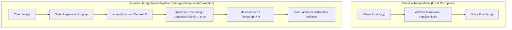
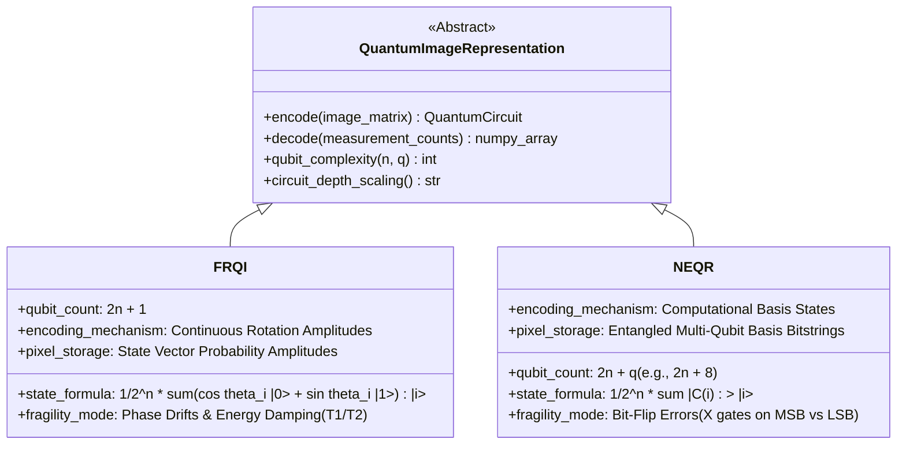
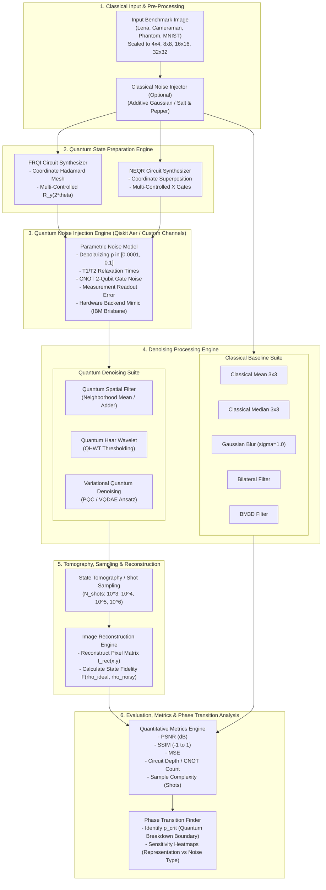

# Quantum Image Robustness & Denoising Framework (QIP)

[](LICENSE)
[](https://www.python.org/downloads/)
[](https://qiskit.org/)
[](#current-project-status)

> **How Robust Are Quantum Images? Investigating Noise Propagation, Representation Fragility, and Quantum-Assisted Denoising under NISQ Realities.**

An empirical and theoretical quantum computing research and systems engineering framework comparing **FRQI** (Flexible Representation of Quantum Images) and **NEQR** (Novel Enhanced Quantum Representation) under realistic quantum noise channels (Depolarizing, Amplitude Damping $T_1$, Dephasing $T_2$, and Readout Error), formulating a **Quantum-Assisted Wavelet/Spatial Denoising Pipeline**, and establishing the critical breakdown boundary where quantum representations collapse compared to classical filters (Gaussian, Median, Bilateral, BM3D).

---

## 1. Project Overview

Quantum Image Processing (QIP) harnesses superposition, entanglement, and quantum interference to perform visual computational tasks—such as edge detection, image segmentation, filtering, and classification—with theoretical speedups over classical algorithms.

However, most published QIP literature assumes an **ideal, fault-tolerant quantum computer** executing error-free unitaries on pure states $|\psi\rangle$. Real quantum hardware in the **Noisy Intermediate-Scale Quantum (NISQ)** era is an open quantum system subject to environmental decoherence, gate infidelity, coherent over-rotation errors, and measurement readout confusion.

When an image is encoded into a quantum register, quantum noise does not simply corrupt pixel values independently; it corrupts quantum state amplitudes and phases, causing **non-local, entanglement-propagated reconstruction artifacts** across the image.



---

## 2. Core Research Questions

- **RQ1 (Representation Fragility):** Does continuous amplitude encoding (FRQI) exhibit higher vulnerability to phase dephasing ($T_2$) and amplitude damping ($T_1$) compared to discrete computational basis encoding (NEQR)? How do bit-flip ($X$) errors in NEQR compare to angle rotation drifts ($\Delta \theta$) in FRQI?
- **RQ2 (Error Localization vs. Non-Local Bleed):** In multi-qubit entanglement networks used for coordinate addressing, does a single physical gate failure corrupt an isolated pixel or bleed across an entire quadrant/row due to controlled multiplexer cascade gates?
- **RQ3 (Quantum-Assisted Denoising Feasibility):** Can a quantum spatial filter or Quantum Haar Wavelet Transform (QHWT) filter out noise on a noisy quantum simulator or real NISQ device, or does the added gate depth of the denoising circuit introduce more noise than it eliminates?
- **RQ4 (The Quantum Advantage Horizon):** At what physical error rate $p_{\text{crit}}$ and shot budget $N_{\text{shots}}$ does classical filtering strictly dominate quantum-assisted approaches in both PSNR and computational runtime?

---

## 3. Quantum Image Representations: FRQI vs. NEQR



| Feature | FRQI (Flexible Representation) | NEQR (Novel Enhanced Quantum Representation) |
| :--- | :--- | :--- |
| **Qubit Complexity** | $2n + 1$ qubits | $2n + q$ qubits ($q=8$ for 8-bit grayscale) |
| **Encoding Principle** | Continuous statevector rotation angle $\theta_i \in [0, \pi/2]$ | Discrete computational basis states $\|C_7 \dots C_0\rangle$ |
| **State Formula** | $\frac{1}{2^n}\sum_{i} (\cos\theta_i\|0\rangle + \sin\theta_i\|1\rangle)\|i\rangle$ | $\frac{1}{2^n}\sum_{i} \|C(i)\rangle \otimes \|i\rangle$ |
| **Primary Fragility** | Energy relaxation ($T_1$) systematically dims image; dephasing ($T_2$) degrades phase | Bit-flip errors ($X$); severe non-uniformity between MSB ($C_7$) and LSB ($C_0$) |
| **Reconstruction** | Requires heavy shot sampling ($N \ge 10^5$) for amplitude tomography | Direct basis bitstring frequency sampling |

---

## 4. End-to-End System Architecture



---

## 5. Current Project Status

> **Milestone:** Initial Project Scaffolding & Setup Established
>
> The project skeleton, packaging configuration, configuration profiles, testing harness, and module interfaces have been generated in accordance with [`PLAN.md`](PLAN.md).

- [x] Research and Engineering Blueprint ([`PLAN.md`](PLAN.md))
- [x] Repository Architecture and Directory Scaffolding
- [x] Packaging (`pyproject.toml`, `requirements.txt`, `environment.yml`)
- [x] Preset Noise Profiles & Hardware Configuration (`config/`)
- [x] Baseline Filter Suite and Metric Calculator (`src/metrics/`, `src/classical_denoising/`)
- [x] Unit Test Infrastructure (`tests/`)
- [ ] **Phase 1 (Upcoming):** FRQI/NEQR Circuit Transpilation and Parameterized Aer Noise Models
- [ ] **Phase 2:** Quantum Haar Wavelet & Spatial Adder Denoising Circuits
- [ ] **Phase 3:** Large-Scale Empirical Noise Sweeps (EXP-01 through EXP-05)
- [ ] **Phase 4:** Phase Transition ($p_{\text{crit}}$) Identification & Scientific Manuscript

---

## 6. Repository Structure

```
.
├── config/
│   ├── benchmark_images.yaml         # Target image sizes and synthetic test patterns
│   ├── hardware_backends.yaml        # IBM Quantum calibration snapshots (FakeBrisbane)
│   └── noise_profiles.yaml           # Preset noise parameters (T1, T2, infidelities)
├── data/
│   ├── experiment_results/           # Raw measurement counts and run caches (.gitkeep)
│   ├── noisy_classical/              # Pre-corrupted test images (.gitkeep)
│   └── raw_images/                   # Clean benchmark image files (.gitkeep)
├── notebooks/                        # Interactive Jupyter notebooks (.gitkeep)
├── src/
│   ├── classical_denoising/          # Classical Baseline Filters
│   │   ├── __init__.py
│   │   ├── bm3d_wrapper.py           # BM3D comparative baseline wrapper
│   │   └── standard_filters.py       # Mean, Median, Gaussian, Bilateral implementations
│   ├── encoding/                     # Quantum Image State Preparation
│   │   ├── __init__.py
│   │   ├── frqi.py                   # FRQI circuit builder & state decoder
│   │   └── neqr.py                   # NEQR circuit builder & basis state decoder
│   ├── experiments/                  # Master Batch Execution Scripts
│   │   ├── __init__.py
│   │   ├── run_bitflip_study.py      # Master script for EXP-03
│   │   ├── run_denoising_benchmark.py# Master script for EXP-04 and EXP-05
│   │   └── run_noise_sweep.py        # Master script for EXP-01 and EXP-02
│   ├── metrics/                      # Quantitative Evaluation Metrics
│   │   ├── __init__.py
│   │   ├── image_metrics.py          # PSNR, SSIM, MSE functions
│   │   └── quantum_metrics.py        # State fidelity, circuit depth, CNOT count
│   ├── noise/                        # Quantum Noise Injection Models
│   │   ├── __init__.py
│   │   ├── channels.py               # Depolarizing, T1/T2, and composite noise builders
│   │   └── readout.py                # Measurement confusion matrix simulator
│   ├── quantum_denoising/            # Quantum Image Filtering Circuits
│   │   ├── __init__.py
│   │   ├── qhwt.py                   # Quantum Haar Wavelet Transform & thresholding
│   │   ├── spatial_adder.py          # Quantum Neighborhood Average filter
│   │   └── vqdae.py                  # Variational Quantum Denoising Autoencoder
│   └── __init__.py
├── tests/                            # Unit test suite
│   ├── __init__.py
│   ├── test_denoising.py             # Tests for filter operations
│   ├── test_encoding.py              # Tests for state encoders
│   ├── test_metrics.py               # Tests for PSNR/SSIM/MSE evaluation
│   └── test_noise.py                 # Tests for noise channels
├── .gitignore                        # Git ignore rules for Python, notebooks, and data
├── environment.yml                   # Conda environment specification
├── LICENSE                           # MIT License
├── main.py                           # Unified master CLI and end-to-end pipeline runner
├── PLAN.md                           # Master Research & Systems Engineering Plan
├── pyproject.toml                    # Standard Python package metadata and tool configs
├── README.md                         # Project documentation and current status
└── requirements.txt                  # Python dependencies
```

---

## 7. Getting Started

### Prerequisites
- Python 3.10 or 3.11
- [`uv`](https://github.com/astral-sh/uv) (recommended), `virtualenv`, or `conda`

### Installation

1. **Clone the repository:**
   ```bash
   git clone https://github.com/ojhaprathmesh/QIP_Repo.git
   cd QIP_Repo
   ```

2. **Set up environment:**

   **Option A: Using `uv` (Recommended - fastest setup)**
   ```bash
   uv venv
   source .venv/bin/activate
   uv pip install -r requirements.txt
   uv pip install -e .
   ```

   **Option B: Using standard `venv` and `pip`**
   ```bash
   python3 -m venv .venv
   source .venv/bin/activate
   pip install --upgrade pip
   pip install -r requirements.txt
   pip install -e .
   ```

   **Option C: Using Conda**
   ```bash
   conda env create -f environment.yml
   conda activate qip
   ```

3. **Run the test suite:**
   ```bash
   # With active environment:
   pytest

   # Or directly with uv:
   uv run pytest
   ```

4. **Run the end-to-end pipeline demo:**
   ```bash
   python main.py --demo
   ```
---

## 8. Implementation Roadmap

| Phase | Milestone | Focus Areas |
| :---: | :--- | :--- |
| **Phase 1** | Representation & Noise Modeling | Transpile FRQI and NEQR state-prep circuits; calibrate Depolarizing, $T_1$, $T_2$, and readout error channels in Qiskit Aer. |
| **Phase 2** | Denoising Engine Development | Implement Quantum Haar Wavelet (QHWT) frequency thresholding and NEQR spatial moving average adders; integrate classical baselines (BM3D, Bilateral). |
| **Phase 3** | Large-Scale Empirical Sweeps | Execute EXP-01 to EXP-05; sweep depolarizing rate $p \in [10^{-4}, 10^{-1}]$, $T_1/T_2$ ratios, and NEQR color-bit significance. |
| **Phase 4** | Analysis, Phase Transitions & Paper | Compute empirical $p_{\text{crit}}$ breakdown boundaries; produce publication-grade figures and research paper manuscript. |

---

## 9. References & Theoretical Foundations

1. Le, P. Q., Dong, F., & Hirota, K. (2011). *A flexible representation of quantum images for polynomial preparation, image compression, and processing processing operations.* Quantum Information Processing, 10(1), 63-84.
2. Zhang, Y., Lu, K., Gao, Y., & Wang, M. (2013). *NEQR: a novel enhanced quantum representation of digital images.* Quantum Information Processing, 12(8), 2833-2860.
3. Nielsen, M. A., & Chuang, I. L. (2010). *Quantum Computation and Quantum Information.* Cambridge University Press.
4. Dabov, K., Foi, A., Katkovnik, V., & Egiazarian, K. (2007). *Image denoising by sparse 3-D transform-domain collaborative filtering.* IEEE Transactions on Image Processing, 16(8), 2080-2095.

---

## 10. License

This project is licensed under the MIT License - see the [LICENSE](LICENSE) file for details.
