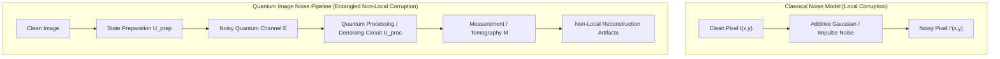
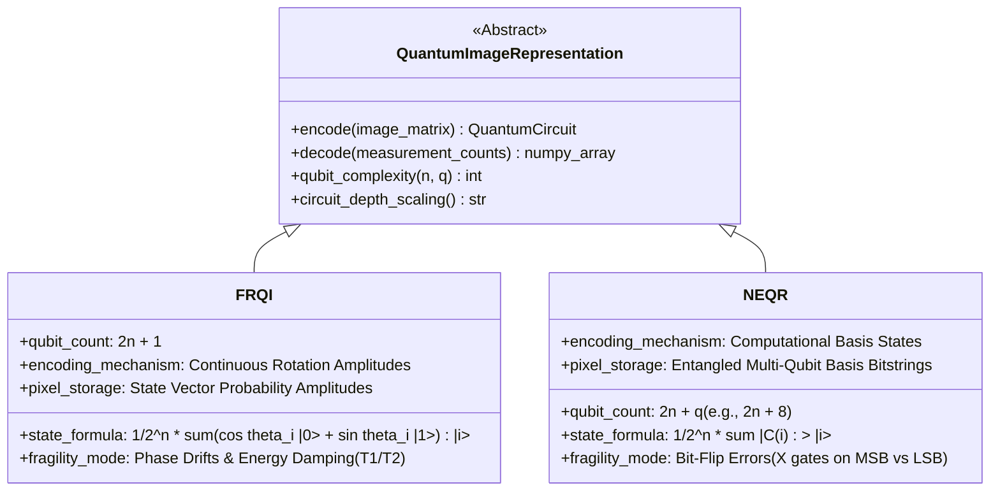
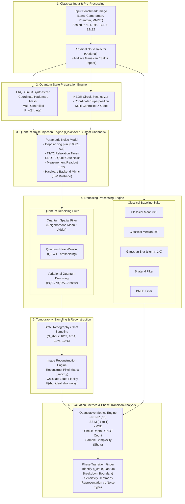

# Quantum Image Robustness & Denoising Framework (QIP)

[](LICENSE)
[](https://www.python.org/downloads/)
[](https://qiskit.org/)
[](https://github.com/ojhaprathmesh/QIP_Repo/actions/workflows/ci.yml)
[](https://qip.ojhaprathmesh.in)
[](#current-project-status)

> **How Robust Are Quantum Images? Investigating Noise Propagation, Representation Fragility, and Quantum-Assisted Denoising under NISQ Realities.**
>
> 🌐 **Live Web Application:** [https://qip.ojhaprathmesh.in](https://qip.ojhaprathmesh.in)  
> ⚡ **FastAPI Backend (Render):** [https://qip-backend.onrender.com](https://qip-backend.onrender.com) (Swagger Docs: [`/docs`](https://qip-backend-93n1.onrender.com/docs), Health: [`/healthz`](https://qip-backend-93n1.onrender.com/healthz))

An empirical and theoretical quantum computing research and systems engineering framework comparing **FRQI** (Flexible Representation of Quantum Images) and **NEQR** (Novel Enhanced Quantum Representation) under realistic quantum noise channels (Depolarizing, Amplitude Damping $T_1$, Dephasing $T_2$, and Readout Error), formulating a **Quantum-Assisted Wavelet/Spatial Denoising Pipeline**, and establishing the critical breakdown boundary where quantum representations collapse compared to classical filters (Gaussian, Median, Bilateral, BM3D).

---

## 1. Project Overview

Quantum Image Processing (QIP) harnesses superposition, entanglement, and quantum interference to perform visual computational tasks—such as edge detection, image segmentation, filtering, and classification—with theoretical speedups over classical algorithms.

However, most published QIP literature assumes an **ideal, fault-tolerant quantum computer** executing error-free unitaries on pure states $|\psi\rangle$. Real quantum hardware in the **Noisy Intermediate-Scale Quantum (NISQ)** era is an open quantum system subject to environmental decoherence, gate infidelity, coherent over-rotation errors, and measurement readout confusion.

When an image is encoded into a quantum register, quantum noise does not simply corrupt pixel values independently; it corrupts quantum state amplitudes and phases, causing **non-local, entanglement-propagated reconstruction artifacts** across the image.



---

## 2. Core Research Questions

- **RQ1 (Representation Fragility):** Does continuous amplitude encoding (FRQI) exhibit higher vulnerability to phase dephasing ($T_2$) and amplitude damping ($T_1$) compared to discrete computational basis encoding (NEQR)? How do bit-flip ($X$) errors in NEQR compare to angle rotation drifts ($\Delta \theta$) in FRQI?
- **RQ2 (Error Localization vs. Non-Local Bleed):** In multi-qubit entanglement networks used for coordinate addressing, does a single physical gate failure corrupt an isolated pixel or bleed across an entire quadrant/row due to controlled multiplexer cascade gates?
- **RQ3 (Quantum-Assisted Denoising Feasibility):** Can a quantum spatial filter or Quantum Haar Wavelet Transform (QHWT) filter out noise on a noisy quantum simulator or real NISQ device, or does the added gate depth of the denoising circuit introduce more noise than it eliminates?
- **RQ4 (The Quantum Advantage Horizon):** At what physical error rate $p_{\text{crit}}$ and shot budget $N_{\text{shots}}$ does classical filtering strictly dominate quantum-assisted approaches in both PSNR and computational runtime?

---

## 3. Quantum Image Representations: FRQI vs. NEQR



| Feature | FRQI (Flexible Representation) | NEQR (Novel Enhanced Quantum Representation) |
| :--- | :--- | :--- |
| **Qubit Complexity** | $2n + 1$ qubits | $2n + q$ qubits ($q=8$ for 8-bit grayscale) |
| **Encoding Principle** | Continuous statevector rotation angle $\theta_i \in [0, \pi/2]$ | Discrete computational basis states $\|C_7 \dots C_0\rangle$ |
| **State Formula** | $\frac{1}{2^n}\sum_{i} (\cos\theta_i\|0\rangle + \sin\theta_i\|1\rangle)\|i\rangle$ | $\frac{1}{2^n}\sum_{i} \|C(i)\rangle \otimes \|i\rangle$ |
| **Primary Fragility** | Energy relaxation ($T_1$) systematically dims image; dephasing ($T_2$) degrades phase | Bit-flip errors ($X$); severe non-uniformity between MSB ($C_7$) and LSB ($C_0$) |
| **Reconstruction** | Requires heavy shot sampling ($N \ge 10^5$) for amplitude tomography | Direct basis bitstring frequency sampling |

---

## 4. End-to-End System Architecture



---

## 5. Current Project Status

> **Milestone:** All 6 Research & Engineering Phases Fully Implemented & Deployed
>
> The complete end-to-end quantum simulation engine, REST API, WebSocket streaming bridge, Next.js 16 Web Studio, and automated CI test suite (**48/48 tests passing**) are fully operational.

- [x] **Research & Engineering Blueprint:** Exhaustive specification and proofs ([`PLAN.md`](PLAN.md))
- [x] **Repository Architecture & Packaging:** Deterministic `uv.lock` dependency locking, zero legacy `requirements.txt` debt
- [x] **Phase 1 (Representation & Noise):** FRQI & NEQR circuits, Aer Depolarizing, $T_1$, $T_2$, and Readout Kraus models
- [x] **Phase 2 (Denoising Engines):** Quantum Haar Wavelet (QHWT), Spatial Adder, VQDAE, and Classical Baseline suite (BM3D, Bilateral, Median, Gaussian)
- [x] **Phase 3A (Simulation Backend):** FastAPI server (`api/server.py`) with `/ws/simulate`, `/api/health`, `/healthz`, and REST benchmarks
- [x] **Phase 3B (Quantum Studio UI):** Next.js 16 App Router interface (`ui/`) with 6 stages, responsive 100vh viewport, and vertical pipeline stepper
- [x] **Phase 4 (Empirical Sweeps):** Parametric noise sweep, NEQR bit-flip sensitivity study, and denoising benchmark datasets tracked in `data/experiment_results/`
- [x] **Phase 5 (Containerization & Deployment):** Multi-stage `Dockerfile`, `docker-compose.yml`, `render.yaml`, GitHub Actions CI, and production deployment at [`qip.ojhaprathmesh.in`](https://qip.ojhaprathmesh.in)
- [x] **Phase 6 (Academic Manuscript):** Publication-ready IEEE-format LaTeX paper and vector figures in `paper/`

---

## 6. Repository Structure

```
.
.
├── api/                                # FastAPI Streaming Microservice & REST APIs
│   ├── event_bus.py                   # In-process asynchronous Pub/Sub dispatcher
│   ├── schemas.py                     # Pydantic v2 simulation request & telemetry models
│   └── server.py                      # REST endpoints (/healthz, /api/benchmarks/*) & WebSocket (/ws/simulate)
├── config/
│   ├── benchmark_images.yaml         # Target image sizes and synthetic test patterns
│   ├── hardware_backends.yaml        # IBM Quantum calibration snapshots (FakeBrisbane)
│   └── noise_profiles.yaml           # Preset noise parameters (T1, T2, infidelities)
├── data/
│   ├── experiment_results/           # Tracked benchmark datasets (noise_sweep, bitflip_study, denoising)
│   ├── noisy_classical/              # Pre-corrupted test images (.gitkeep)
│   └── raw_images/                   # Clean benchmark image files (.gitkeep)
├── notebooks/                        # Interactive Jupyter notebooks (.gitkeep)
├── paper/                            # Publication-grade IEEEtran LaTeX paper & figures
├── src/
│   ├── classical_denoising/          # Classical Baseline Filters (BM3D, Bilateral, Median, Gaussian)
│   ├── encoding/                     # Quantum Image State Preparation (FRQI & NEQR)
│   ├── experiments/                  # Master Batch Execution Sweeps (EXP-01 through EXP-05)
│   ├── metrics/                      # PSNR, SSIM, MSE, State Fidelity, Circuit Depth, CNOT count
│   ├── noise/                        # CPTP Kraus Noise Models (Depolarizing, T1/T2, Readout Confusion)
│   └── quantum_denoising/            # QHWT, Spatial Moving Average Adder, and PennyLane/Qiskit VQDAE
├── tests/                            # Comprehensive Automated Test Suite (48 tests passing)
│   ├── test_api.py                   # REST endpoints, WebSocket simulation, and telemetry
│   ├── test_denoising.py             # QHWT and Spatial Adder filter tests
│   ├── test_denoising_benchmark.py   # EXP-04/05 benchmark runner tests
│   ├── test_encoding.py              # FRQI & NEQR lossless & shot tests
│   ├── test_metrics.py               # PSNR/SSIM/MSE evaluation tests
│   ├── test_noise.py                 # CPTP Kraus channel tests
│   ├── test_sweeps.py                # EXP-01/02/03 runner tests
│   └── test_vqdae.py                 # VQDAE ansatz, optimization, and denoising tests
├── ui/                               # Next.js 16 Real-Time Quantum Studio Dashboard
│   ├── app/                          # Next.js App Router (layout, page, globals.css)
│   ├── components/                   # 6-Stage modular pipeline stages & vertical stepper
│   ├── lib/                          # Zustand store, WebSocket stream hook, types
│   └── package.json                  # Next.js 16, React 19, Tailwind CSS v4, Lucide, Recharts
├── .github/workflows/ci.yml          # Automated multi-version CI (Python 3.11, 3.12, Node 20)
├── docker-compose.yml                # Unified multi-service orchestration
├── Dockerfile                        # Multi-stage production backend container
├── render.yaml                       # Render Cloud deployment blueprint
├── main.py                           # Master CLI and end-to-end pipeline runner
├── pyproject.toml                    # Modern package metadata & dev dependency specification
├── uv.lock                           # Deterministic pinned dependency lockfile
├── GUIDE.md                          # Step-by-step setup and execution guide
├── PLAN.md                           # Master Research & Systems Engineering Plan
├── PREP.md                           # Mid-term project defense and viva battlepack
├── PROGRESS_REPORT.md                # Comprehensive project progress report
└── README.md                         # Main documentation and deployment overview
```

---

## 7. Getting Started

### Prerequisites
- Python 3.10 to 3.14 (managed via `uv`)
- Node.js 20+ (for the Next.js UI)
- [`uv`](https://github.com/astral-sh/uv) (recommended for deterministic lockfile execution)

### Installation & Local Setup

1. **Clone the repository:**
   ```bash
   git clone https://github.com/ojhaprathmesh/QIP_Repo.git
   cd QIP_Repo
   ```

2. **Install Python backend dependencies from `uv.lock`:**
   ```bash
   # Sync virtual environment deterministically
   uv sync --frozen --all-extras
   source .venv/bin/activate
   ```

3. **Run the 48-test verification suite:**
   ```bash
   uv run --no-sync pytest -v
   ```

4. **Launch the FastAPI Simulation Backend:**
   ```bash
   uvicorn api.server:app --reload --host 0.0.0.0 --port 8000
   ```
   * REST Health Check: `http://localhost:8000/healthz`
   * WebSocket Streaming: `ws://localhost:8000/ws/simulate`
   * Benchmark Datasets: `http://localhost:8000/api/benchmarks/noise-sweep`

5. **Launch the Next.js 16 Quantum Studio UI:**
   ```bash
   cd ui
   npm ci
   npm run dev
   ```
   Visit `http://localhost:3000` to interact with the full 6-stage studio.

### Production Deployment

* **Frontend (Vercel):** [https://qip.ojhaprathmesh.in](https://qip.ojhaprathmesh.in)
* **Backend (Render):** Automatically deployed via [`render.yaml`](render.yaml) with native `uv.lock` frozen sync and health checks at `/healthz`.
* **Docker:** Launch everything locally via `docker compose up --build`.
---

## 8. Implementation Roadmap

| Phase | Milestone | Focus Areas |
| :---: | :--- | :--- |
| **Phase 1** | Representation & Noise Modeling | Transpile FRQI and NEQR state-prep circuits; calibrate Depolarizing, $T_1$, $T_2$, and readout error channels in Qiskit Aer. |
| **Phase 2** | Denoising Engine Development | Implement Quantum Haar Wavelet (QHWT) frequency thresholding and NEQR spatial moving average adders; integrate classical baselines (BM3D, Bilateral). |
| **Phase 3** | Large-Scale Empirical Sweeps | Execute EXP-01 to EXP-05; sweep depolarizing rate $p \in [10^{-4}, 10^{-1}]$, $T_1/T_2$ ratios, and NEQR color-bit significance. |
| **Phase 4** | Analysis, Phase Transitions & Paper | Compute empirical $p_{\text{crit}}$ breakdown boundaries; produce publication-grade figures and research paper manuscript. |

---

## 9. References & Theoretical Foundations

1. Le, P. Q., Dong, F., & Hirota, K. (2011). *A flexible representation of quantum images for polynomial preparation, image compression, and processing processing operations.* Quantum Information Processing, 10(1), 63-84.
2. Zhang, Y., Lu, K., Gao, Y., & Wang, M. (2013). *NEQR: a novel enhanced quantum representation of digital images.* Quantum Information Processing, 12(8), 2833-2860.
3. Nielsen, M. A., & Chuang, I. L. (2010). *Quantum Computation and Quantum Information.* Cambridge University Press.
4. Dabov, K., Foi, A., Katkovnik, V., & Egiazarian, K. (2007). *Image denoising by sparse 3-D transform-domain collaborative filtering.* IEEE Transactions on Image Processing, 16(8), 2080-2095.

---

## 10. License

This project is licensed under the MIT License - see the [LICENSE](LICENSE) file for details.
